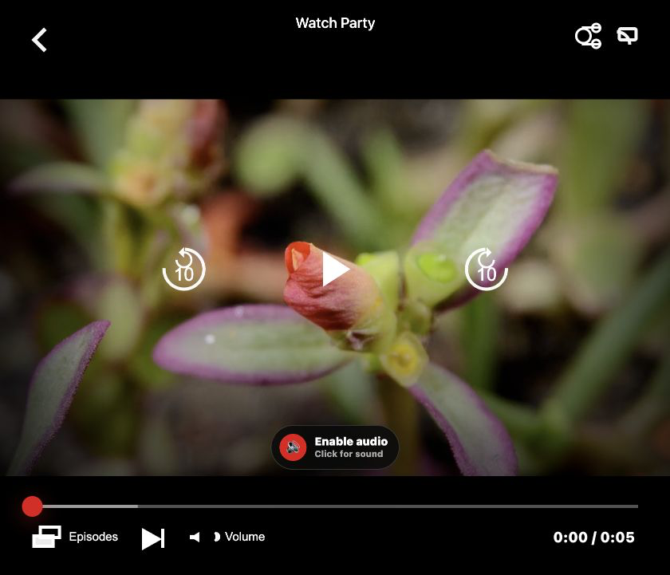
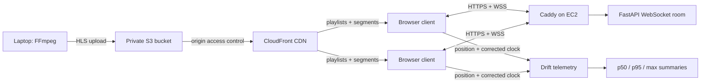

# Watch Party Sync

**A production-deployed watch-party service that keeps browser video players synchronized over WebSockets and measures playback drift.**

[**Open the live demo**](https://77-113-136-165.sslip.io) · FastAPI · WebSockets · HLS · FFmpeg · AWS



## Key results

- Deployed on **AWS EC2, S3, and CloudFront** with HTTPS and secure WebSockets through Caddy.
- Recovered from a seek in **55 ms on a good network** and about **608 ms at 300 ms delay + 2% loss**.
- Held **12 ms p95 event latency at 3,200 simulated clients** on one laptop.
- Used drift telemetry to find and fix an initiator timestamp bug: playback actions are now echoed to the initiating client with the authoritative server timestamp.
- Protects the stream proxy against SSRF by rejecting private, loopback, link-local, reserved, and non-HTTP destinations and revalidating redirects.

All figures come from checked-in benchmark runs. See [benchmark methods, tables, and limitations](docs/BENCHMARKS.md).

## Architecture



Each browser sends playback position, play state, and NTP-style corrected time every two seconds. The server projects recent positions to the same corrected-clock instant, applies play/pause/seek against an authoritative timeline, and reports session-wide and steady-state drift. Local mode can proxy and transcode a pasted media URL; AWS mode serves pre-transcoded HLS directly from CloudFront while EC2 handles room state and WebSockets.

## Run locally

Requirements: Python 3.11+, FFmpeg/ffprobe, and a direct media URL that the host can access.

```bash
python3 -m venv .venv
source .venv/bin/activate
python -m pip install -r requirements.txt
python -m uvicorn server:app --host 127.0.0.1 --port 8000
```

Open <http://localhost:8000>, paste a direct video or stream URL, create a room, and share its link. The optional `python server.py` entry point also attempts a Cloudflare Quick Tunnel when `cloudflared` is installed.

The public demo is intentionally limited to preloaded licensed content uploaded through `scripts/transcode_upload.sh`; public paste-a-link and `/stream` proxy access are disabled. The included demo is **Big Buck Bunny © Blender Foundation, CC BY 3.0.** Local mode retains the original paste-a-link and stream-proxy workflow.

The encoder defaults to VideoToolbox on macOS and `libx264` elsewhere. Override it with `FFMPEG_VIDEO_ENCODER`; tune software encoding with `FFMPEG_PRESET`. Each room creates 360p, 720p, and 1080p HLS renditions with AAC audio and three-second segments.

## Test and reproduce

```bash
python -m pip install -r requirements-dev.txt
python -m pytest -q
```

Reproduce the network and capacity tests with the commands in [docs/BENCHMARKS.md](docs/BENCHMARKS.md). Tests cover HLS URL rewriting, clock-offset math, validation, Prometheus output, corrected-time drift projection, drift summaries, ABR content, telemetry persistence, and FFmpeg variant-map generation.

## API and observability

| Route | Purpose |
| --- | --- |
| `POST /api/create` | Create a room from `stream_url` and optional `title`. |
| `GET /api/room/{room_id}` | Playback state, stream URL, participants, drift, and duration. |
| `GET /api/room/{room_id}/measurements` | Session p50/p95/max drift summary. |
| `GET /api/analytics` | Session count, unique users, and aggregate duration. |
| `WS /ws/{room_id}` | Clock, playback, video-change, and measurement events. |
| `GET /health` | Liveness, FFmpeg detection, mode, and active rooms. |
| `GET /metrics` | Prometheus-text counters and gauges. |

For the Ohio-region AWS stack, environment modes, one-command HLS upload, persistent usage summaries, redeployment, and the measured cost model, see [docs/DEPLOY_AWS.md](docs/DEPLOY_AWS.md).

## Current constraints

- One process only: horizontal scaling requires shared room state/pub-sub and shared or object-backed HLS storage.
- Rooms live until process restart; add expiry/persistence before operating a long-lived public service.
- Participants are trusted; there is no authentication or room-owner permission model.
- Pasted sources must be direct HTTP(S) media; authenticated, DRM-protected, and webpage URLs are unsupported.

## License

[MIT](LICENSE)
