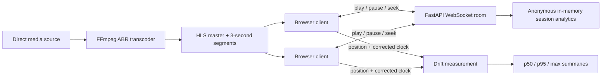
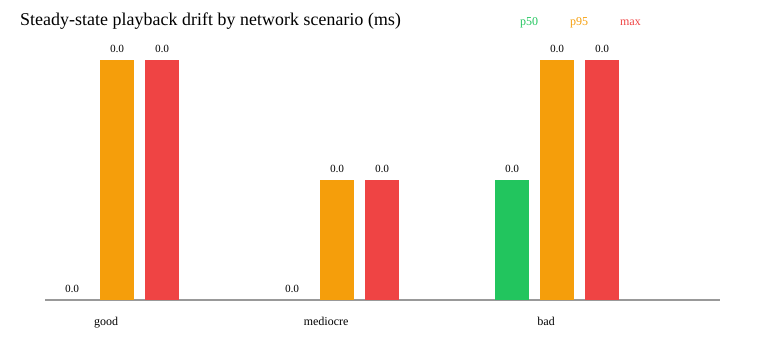
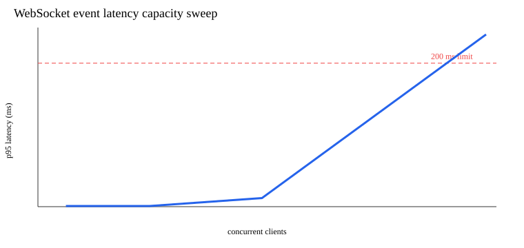
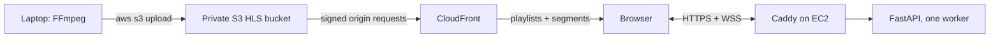

# Watch Party Sync

**A production-deployed watch-party service that keeps browser video players synchronized over WebSockets and measures the resulting playback drift.**

[**Open the live demo**](https://77-113-136-165.sslip.io) · FastAPI · WebSockets · HLS · FFmpeg · AWS EC2/S3/CloudFront

## At a glance

- Synchronizes play, pause, and seek against an authoritative server timeline, with NTP-style browser clock correction.
- Held **12 ms p95 event latency at 3,200 simulated clients** in the checked-in local load test; p95 reached 240 ms at 6,400 clients.
- Separates steady-state drift from short action-transition windows and publishes p50/p95/max telemetry.
- Runs publicly on one low-cost EC2 instance behind Caddy HTTPS, while private S3 and CloudFront handle adaptive video delivery.
- Keeps transcoding off the server: one local command creates 360p/720p/1080p HLS renditions and uploads them to S3.

The figures and CSVs below are outputs from reproducible benchmark runs, not estimates. The public demo accepts direct, browser-compatible media or HLS URLs; uploaded media is delivered through CloudFront.

## Architecture



Each client reports its playback position, play state, and corrected server-clock time every two seconds. The server projects all recent positions to the newest corrected-clock instant before calculating the maximum separation, avoiding false drift caused only by reports arriving at different times. It retains a clearly labeled session-wide summary and a steady-state summary that excludes samples for three seconds after play, pause, or seek. The exclusion is configurable with `DRIFT_STEADY_STATE_DELAY_SECONDS`. Both summaries are logged as JSON every 20 samples and on disconnect, and exposed through `GET /api/room/{room_id}/measurements`.

Playback actions are echoed to every client, including the initiator, with the authoritative server timestamp. This prevents the initiating player from remaining ahead by its outbound network delay.

## Measured results

These are checked-in outputs from actual runs on September 30, 2026 against one local Uvicorn worker on macOS with transcoding disabled to isolate synchronization and WebSocket capacity. They are not production promises. The network runner used three synthetic playback clients and real WebSocket/server measurement traffic. Delay is injected per direction at the application-message layer.

Steady-state drift, excluding the three seconds after each playback action:

| Scenario | Injected condition | Samples | Drift p50 | Drift p95 | Drift max |
| --- | --- | ---: | ---: | ---: | ---: |
| Good | 20 ms delay | 56 | 0.000 ms | 0.002 ms | 0.002 ms |
| Mediocre | 150 ms delay + 50 ms jitter | 41 | 0.000 ms | 0.001 ms | 0.001 ms |
| Bad | 300 ms delay + 2% loss | 32 | 0.001 ms | 0.002 ms | 0.002 ms |

Session-wide drift, including action transitions:

| Scenario | Samples | Drift p50 | Drift p95 | Drift max | Seek recovery | Pause recovery |
| --- | ---: | ---: | ---: | ---: | ---: | ---: |
| Good | 179 | 0.000 ms | 0.914 ms | 40,943.891 ms | 55.107 ms | 54.221 ms |
| Mediocre | 119 | 0.001 ms | 329.761 ms | 40,833.029 ms | 295.678 ms | 376.644 ms |
| Bad | 85 | 0.001 ms | 32,480.914 ms | 40,694.393 ms | 607.972 ms | 609.184 ms |

The very large session-wide maxima are genuine transition samples: one client has applied the 45-second benchmark seek while another client's delayed pre-seek report is still current. They remain visible in the session-wide metric rather than being discarded. Recovery is the elapsed time after the action until all three clients agree on play state and are within 200 ms.



The Locust capacity sweep ran both Uvicorn and Locust on one MacBook Pro with an Apple M4 (10 cores), 16 GB RAM, and macOS 15.7.3. It used 100 rooms, a spawn rate of 800 clients/second, 12-second stages, position reports, and WebSocket ping/pong event timing. It recorded no sync-event failures in these stages:

| Concurrent clients | Event latency p95 |
| ---: | ---: |
| 400 | 1 ms |
| 800 | 1 ms |
| 1,600 | 1 ms |
| 3,200 | 12 ms |
| 6,400 | 240 ms |

Under this specific local test, the requested 200 ms p95 limit was first exceeded at **6,400 concurrent clients**. The last tested capacity below the limit was **3,200 clients**. Raw and consolidated outputs are in [`results/`](results/).

**Load-test summary:** Load-tested with Locust on a single laptop to 6,400 simulated clients, holding p95 event latency at 12 ms through 3,200 clients; p95 reached 240 ms at 6,400 clients.



## Run locally

Requirements: Python 3.11+, FFmpeg/ffprobe, and a direct media URL that the host may access.

```bash
python3 -m venv .venv
source .venv/bin/activate
python -m pip install -r requirements.txt
python -m uvicorn server:app --host 127.0.0.1 --port 8000
```

Open <http://localhost:8000>. The optional `python server.py` entry point also attempts a Cloudflare Quick Tunnel when `cloudflared` is installed.

The encoder defaults to VideoToolbox on macOS and `libx264` elsewhere. Override it with `FFMPEG_VIDEO_ENCODER`; tune software encoding with `FFMPEG_PRESET`. Each room creates an HLS master playlist with 640×360 at 800 kbps, 1280×720 at 2.8 Mbps, and 1920×1080 at 5 Mbps, plus AAC audio and three-second segments.

## Measurement and load tooling

Install test dependencies and start an isolated benchmark server:

```bash
python -m pip install -r requirements-dev.txt
WATCHPARTY_DISABLE_TRANSCODING=1 python -m uvicorn server:app --port 8000
```

Run the network scenarios and regenerate their CSV/chart:

```bash
python tools/network_benchmark.py --base-url http://127.0.0.1:8000 --output results
```

For manual browser testing through an impairment proxy:

```bash
python tools/ws_netem_proxy.py \
  --upstream ws://127.0.0.1:8000 \
  --port 9000 --delay-ms 150 --jitter-ms 50 --loss 0
```

Run a capacity sweep; it stops after p95 exceeds 200 ms:

```bash
python load/run_capacity.py \
  --base-url http://127.0.0.1:8000 \
  --users 400 800 1600 3200 6400 \
  --rooms 100 --spawn-rate 800 --duration 12s --output results
```

Use longer stages and a separate load generator for release qualification. The short checked-in run is reproducible evidence for this machine, not a universal capacity rating.

## API and observability

| Route | Purpose |
| --- | --- |
| `POST /api/create` | Create a room from `stream_url` and optional `title`. |
| `GET /api/room/{room_id}` | Playback state, stream URL, preparation, participant count, drift, and duration. |
| `GET /api/room/{room_id}/measurements` | Session p50/p95/max drift summary. |
| `GET /api/analytics` | Session count, unique users, and aggregate session duration. |
| `WS /ws/{room_id}` | Clock, playback, video-change, and measurement events. |
| `GET /hls/{room_id}/master.m3u8` | Adaptive HLS master playlist. |
| `GET /health` | Liveness, FFmpeg detection, transcoding mode, and active rooms. |
| `GET /metrics` | Prometheus-text counters and gauges. |

Local analytics are process-local. On AWS, random browser-session UUIDs, session timestamps, and
drift samples persist in a server-side Docker volume so usage survives app redeploys. The app does
not retain names, email addresses, IP addresses, user-agent strings, or other personal data.

## Tests

```bash
python -m pytest -q
```

Tests cover HLS URL rewriting, clock-offset math, validation, Prometheus output, corrected-time drift projection, p50/p95/max summaries, ABR master content, and FFmpeg variant-map generation. CI runs them with Python 3.11.

## AWS deployment in Ohio

The AWS layout keeps expensive video work off EC2:



CloudFormation creates one `t3.micro` in `us-east-2`, an encrypted 8 GiB gp3 volume, a static
Elastic IP, a private S3 bucket, and a CloudFront distribution using Origin Access Control. Only
ports 80/443 are public; SSH is limited to the public `/32` detected during setup. Caddy obtains and
renews the public TLS certificate and proxies HTTP and WebSocket upgrades to the container. The
instance has an IAM role for Systems Manager and receives no AWS access keys.

The HLS bucket blocks public access. CloudFront adds CORS response headers for `GET`, `HEAD`, and
`OPTIONS`. Playlists cache for 60 seconds (five-minute shared-cache maximum); `.ts` segments have a
one-year immutable cache policy. Video segments never pass through EC2.

### 1. Connect this Mac to AWS

Install AWS CLI v2.32 or newer, which supports browser-based temporary credentials:

```bash
curl -fsSL https://awscli.amazonaws.com/v2/install.sh | bash
export PATH="$HOME/.local/bin:$PATH"
aws --version
aws login --profile watchparty
aws configure set region us-east-2 --profile watchparty
aws sts get-caller-identity --profile watchparty
```

`aws login` opens the AWS sign-in page and caches temporary credentials for up to 12 hours; no
long-lived access key is placed in this repository. If the account uses IAM Identity Center, use
`aws configure sso --profile watchparty` followed by `aws sso login --profile watchparty` instead.
Use a deployment IAM role/user with CloudFormation, EC2, IAM, S3, and CloudFront permissions; do
not create root-user access keys.

Create a local SSH key pair. The private key is written only under `~/.ssh` and is never uploaded to
the repository:

```bash
mkdir -p ~/.ssh
aws ec2 create-key-pair \
  --region us-east-2 --profile watchparty \
  --key-name watchparty-ohio \
  --query KeyMaterial --output text > ~/.ssh/watchparty-ohio.pem
chmod 600 ~/.ssh/watchparty-ohio.pem
```

### 2. Create AWS resources

From the repository root:

```bash
AWS_PROFILE=watchparty scripts/aws_bootstrap.sh
```

The command deploys `infra/aws-stack.yaml` and writes resource outputs to the ignored
`.aws-stack.env`; that file contains resource names and addresses, not credentials. CloudFront can
take several minutes to finish deploying.

The bootstrap output includes a free `sslip.io` hostname derived from the static EC2 address, so no
domain purchase or DNS setup is required. To use a domain you control instead, create an `A` record
pointing to `EC2_HOST` from `.aws-stack.env`, wait for it to resolve, and set `APP_DOMAIN` when
redeploying. Route 53 is optional—your existing DNS provider works.

### 3. Deploy or redeploy the app

```bash
export SSH_KEY="$HOME/.ssh/watchparty-ohio.pem"
scripts/redeploy_aws.sh
```

This is also the single redeploy command after code changes. It uploads an archive over SSH,
rebuilds the image, and replaces the two containers. Caddy's certificate state lives in a Docker
volume and survives redeploys. The server runs one Uvicorn worker because rooms are held in memory.
For a custom hostname, run `APP_DOMAIN=watch.example.com scripts/redeploy_aws.sh` after its DNS
record resolves.

### 4. Transcode and upload a video from the laptop

Install FFmpeg locally (`brew install ffmpeg` on macOS), then run one command:

```bash
scripts/transcode_upload.sh "/path/to/movie.mp4" movie-night
```

The script creates 360p, 720p, and 1080p HLS renditions in a temporary local directory, uploads
them with the appropriate content types and cache headers, invalidates only the uploaded playlists,
and prints the CloudFront URL. The temporary HLS directory is deleted when the command finishes.
Enter `movie-night` on the deployed app's home page. In AWS mode, the server expands that ID to
`https://<distribution>.cloudfront.net/media/movie-night/master.m3u8`; locally, the input remains a
normal direct media URL and the existing local FFmpeg/proxy behavior is unchanged.

### Environment modes

| Setting | Local default | AWS container |
| --- | --- | --- |
| `WATCHPARTY_DISABLE_TRANSCODING` | `0` | `1` |
| `WATCHPARTY_DIRECT_MEDIA` | `0` | unset |
| `WATCHPARTY_MEDIA_BASE_URL` | unset | CloudFront `/media` URL |
| `WATCHPARTY_PUBLIC_URL` | unset or Quick Tunnel | `https://APP_DOMAIN` |

In AWS mode, uploaded media IDs are expanded to CloudFront and loaded directly from the CDN.
Pasted `http://` or `https://` media links retain the original `/stream` proxy flow so sources that
lack browser CORS headers can still work. Because AWS intentionally has no FFmpeg, pasted links
must already use browser-compatible codecs; use `scripts/transcode_upload.sh` for incompatible
files or streams. Authenticated, DRM-protected, and webpage URLs are not supported.
AWS proxy mode rejects private, loopback, link-local, reserved, and non-HTTP destinations and
revalidates every redirect, preventing access to EC2 instance metadata and private network hosts.

### Persistent production usage summary

AWS stores telemetry in the `watchparty_telemetry` Docker volume on the EC2 server, so replacing
the app container with `scripts/redeploy_aws.sh` does not erase it. No telemetry database is created
in default local mode. Run:

```bash
scripts/usage_summary_aws.sh
# Machine-readable form:
scripts/usage_summary_aws.sh --json
```

The report includes total rooms/sessions, distinct opaque browser client IDs, mean/p50/max session
length, and steady-state drift sample count plus p50/p95/max. Session length is measured from room
creation to its last observed client activity; a server restart closes an open session at its last
recorded activity. The database stores no names, email addresses, IP addresses, or user-agent
strings. It remains on the instance until the Docker volume or instance is deleted.

### Monthly cost estimate

At 730 hours/month before promotional credits, the fixed baseline is approximately:

| Resource | Assumption | Estimated monthly cost |
| --- | --- | ---: |
| EC2 `t3.micro` | Linux on-demand, `$0.0104/hour` | `$7.59` |
| Public IPv4 / Elastic IP | `$0.005/hour` while attached | `$3.65` |
| EBS gp3 | 8 GiB at `$0.08/GiB-month` | `$0.64` |
| S3 Standard | Example 10 GB at `$0.023/GB-month` | `$0.23` |
| CloudFront | Within perpetual 1 TB transfer + 10 million request allowance | `$0.00` |
| **Example total** | Excluding domain registration and excess usage | **`$12.11/month`** |

New-account credits or legacy EC2/EBS free-tier allowances can reduce that figure, potentially to
the S3/domain portion while credits last. Route 53 adds roughly `$0.50/month` per hosted zone if
used, plus domain registration. Beyond the CloudFront allowance, US delivery starts around
`$0.085/GB`; S3 requests/storage, EC2 data transfer, taxes, and unusually high WebSocket traffic are
variable. Current source pages: [EC2 on-demand pricing](https://aws.amazon.com/ec2/pricing/on-demand/),
[public IPv4 pricing](https://aws.amazon.com/vpc/pricing/),
[EBS pricing](https://aws.amazon.com/ebs/pricing/), [S3 pricing](https://aws.amazon.com/s3/pricing/),
and [CloudFront pricing](https://aws.amazon.com/cloudfront/pricing/).

To stop all compute charges, delete the CloudFormation stack. The HLS bucket is deliberately
retained to prevent accidental video loss; empty and delete it separately only when you no longer
need the uploaded media. Releasing the retained Elastic IP happens with stack deletion.

## Production deployment

The Docker image runs as a non-root user, contains FFmpeg, uses a health check, honors `PORT`, and intentionally starts one worker because room state is in memory.

Fly.io:

```bash
fly launch --no-deploy
# Replace the app value in fly.toml with the generated app name.
fly deploy
```

Railway can deploy the repository directly using `railway.json` and the Dockerfile. Allocate CPU and memory for the number and resolution of simultaneous transcodes you intend to support; WebSocket capacity numbers above do not include FFmpeg load.

Current production constraints:

- One process only: scaling horizontally requires shared room state/pub-sub (for example Redis) and shared/object-backed HLS storage.
- Rooms live until process restart; add expiry/persistence before operating a long-lived public service.
- Participants are trusted; there is no authentication or room-owner permission model.
- Public source URLs are restricted to HTTP(S), resolved and revalidated across redirects, and blocked when they target private, loopback, link-local, or reserved networks.
- Authenticated and DRM-protected sources are unsupported.
