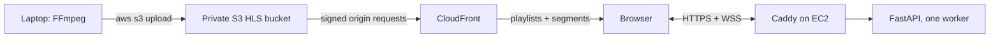

# Deploy to AWS (Ohio)

This deployment keeps compute small and does all video transcoding on the laptop. CloudFormation creates one `t3.micro` in `us-east-2`, an encrypted 8 GiB gp3 volume, a static Elastic IP, a private S3 bucket, and a CloudFront distribution using Origin Access Control.



Only ports 80/443 are public; SSH is limited to the public `/32` detected during setup. Caddy obtains and renews TLS and proxies HTTP and WebSocket upgrades. The instance has an IAM role and receives no AWS access keys. CloudFront supplies CORS headers; playlists cache for 60 seconds with a five-minute shared-cache maximum, while `.ts` segments use a one-year immutable cache policy.

## 1. Connect the AWS CLI

Install AWS CLI v2.32 or newer, which supports browser-based temporary credentials:

```bash
curl -fsSL https://awscli.amazonaws.com/v2/install.sh | bash
export PATH="$HOME/.local/bin:$PATH"
aws --version
aws login --profile watchparty
aws configure set region us-east-2 --profile watchparty
aws sts get-caller-identity --profile watchparty
```

`aws login` opens AWS sign-in and caches temporary credentials for up to 12 hours. With IAM Identity Center, use `aws configure sso --profile watchparty` and `aws sso login --profile watchparty` instead. Use a deployment role/user with CloudFormation, EC2, IAM, S3, and CloudFront permissions; never create root-user access keys.

Create a local SSH key pair. The private key stays under `~/.ssh`:

```bash
mkdir -p ~/.ssh
aws ec2 create-key-pair \
  --region us-east-2 --profile watchparty \
  --key-name watchparty-ohio \
  --query KeyMaterial --output text > ~/.ssh/watchparty-ohio.pem
chmod 600 ~/.ssh/watchparty-ohio.pem
```

## 2. Create AWS resources

```bash
AWS_PROFILE=watchparty scripts/aws_bootstrap.sh
```

The script deploys `infra/aws-stack.yaml` and writes outputs to the ignored `.aws-stack.env`; it contains resource names and addresses, not credentials. The output includes a free `sslip.io` hostname derived from the static EC2 address. For a custom domain, point an `A` record to `EC2_HOST` and set `APP_DOMAIN` during redeploy.

## 3. Deploy and redeploy

```bash
export SSH_KEY="$HOME/.ssh/watchparty-ohio.pem"
scripts/redeploy_aws.sh
```

The same command redeploys after code changes. It uploads an archive over SSH, rebuilds the image, and replaces the two containers. Caddy certificate state and telemetry live in Docker volumes and survive redeploys. The server uses one Uvicorn worker because room state is in memory. For a custom hostname, run `APP_DOMAIN=watch.example.com scripts/redeploy_aws.sh` after DNS resolves.

## 4. Transcode and upload from the laptop

Install FFmpeg locally (`brew install ffmpeg` on macOS), then run:

```bash
scripts/transcode_upload.sh "/path/to/movie.mp4" movie-night
```

The script creates 360p, 720p, and 1080p HLS renditions in a temporary directory, uploads them with the correct content types and cache headers, invalidates only the playlists, and prints the CloudFront URL. Enter `movie-night` on the deployed home page.

## Environment modes

| Setting | Local default | AWS container |
| --- | --- | --- |
| `WATCHPARTY_DISABLE_TRANSCODING` | `0` | `1` |
| `WATCHPARTY_DIRECT_MEDIA` | `0` | unset |
| `WATCHPARTY_MEDIA_BASE_URL` | unset | CloudFront `/media` URL |
| `WATCHPARTY_PUBLIC_URL` | unset or Quick Tunnel | `https://APP_DOMAIN` |

In AWS mode, media IDs expand to CloudFront URLs. Pasted `http://` or `https://` media links retain the `/stream` proxy flow, so sources without browser CORS headers can work, but they must already use browser-compatible codecs because AWS intentionally has no FFmpeg. Authenticated, DRM-protected, and webpage URLs are unsupported. Proxy mode rejects private, loopback, link-local, reserved, and non-HTTP destinations and revalidates redirects.

## Persistent usage summary

AWS stores telemetry in the `watchparty_telemetry` Docker volume, so app redeploys do not erase it. Default local mode does not create a telemetry database.

```bash
scripts/usage_summary_aws.sh
scripts/usage_summary_aws.sh --json
```

The report includes total rooms/sessions, distinct opaque browser client IDs, mean/p50/max session length, and steady-state drift sample count plus p50/p95/max. A restart closes an open session at its last recorded activity. The database stores no names, email addresses, IP addresses, or user-agent strings.

## Monthly cost estimate

At 730 hours/month before promotional credits, the fixed baseline is approximately:

| Resource | Assumption | Estimated monthly cost |
| --- | --- | ---: |
| EC2 `t3.micro` | Linux on-demand, `$0.0104/hour` | `$7.59` |
| Public IPv4 / Elastic IP | `$0.005/hour` while attached | `$3.65` |
| EBS gp3 | 8 GiB at `$0.08/GiB-month` | `$0.64` |
| S3 Standard | Example 10 GB at `$0.023/GB-month` | `$0.23` |
| CloudFront | Within perpetual 1 TB transfer + 10 million request allowance | `$0.00` |
| **Example total** | Excluding domain registration and excess usage | **`$12.11/month`** |

New-account credits or legacy EC2/EBS free-tier allowances can reduce that figure. Route 53 adds roughly `$0.50/month` per hosted zone if used, plus domain registration. Beyond the CloudFront allowance, US delivery starts around `$0.085/GB`; S3 requests/storage, EC2 data transfer, taxes, and unusually high WebSocket traffic are variable. See AWS pricing for [EC2](https://aws.amazon.com/ec2/pricing/on-demand/), [public IPv4](https://aws.amazon.com/vpc/pricing/), [EBS](https://aws.amazon.com/ebs/pricing/), [S3](https://aws.amazon.com/s3/pricing/), and [CloudFront](https://aws.amazon.com/cloudfront/pricing/).

To stop compute charges, delete the CloudFormation stack. The HLS bucket is deliberately retained to prevent accidental video loss; empty and delete it separately only when the media is no longer needed. Stack deletion releases the Elastic IP.
